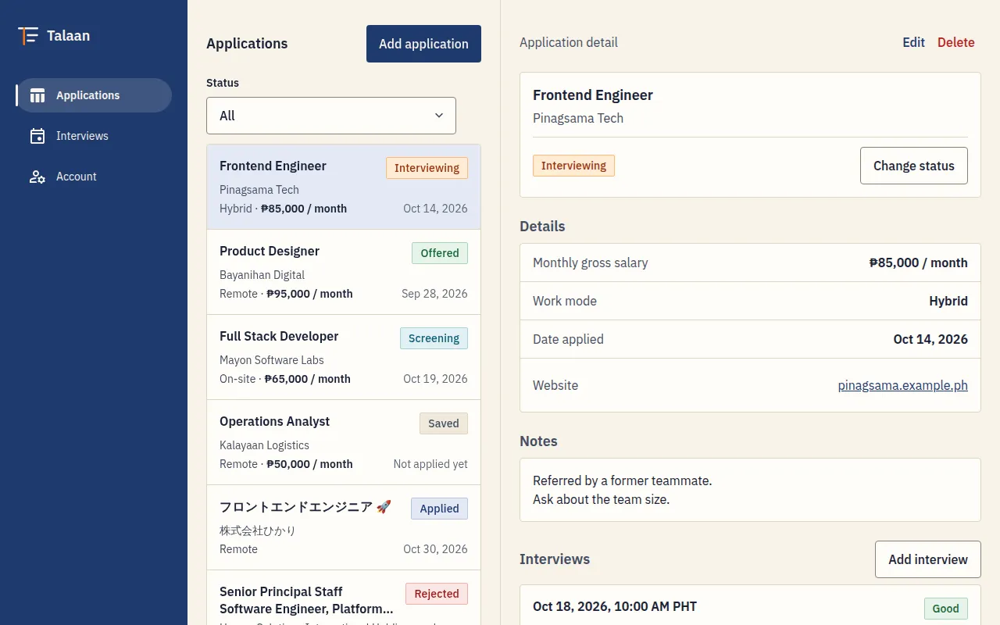
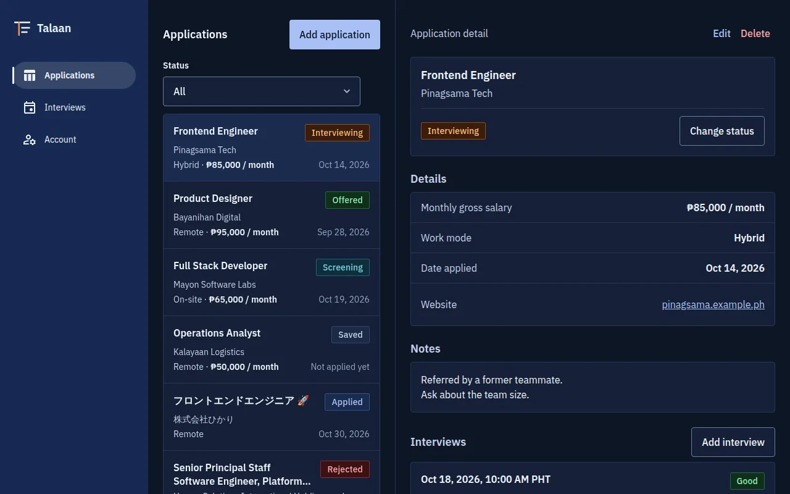
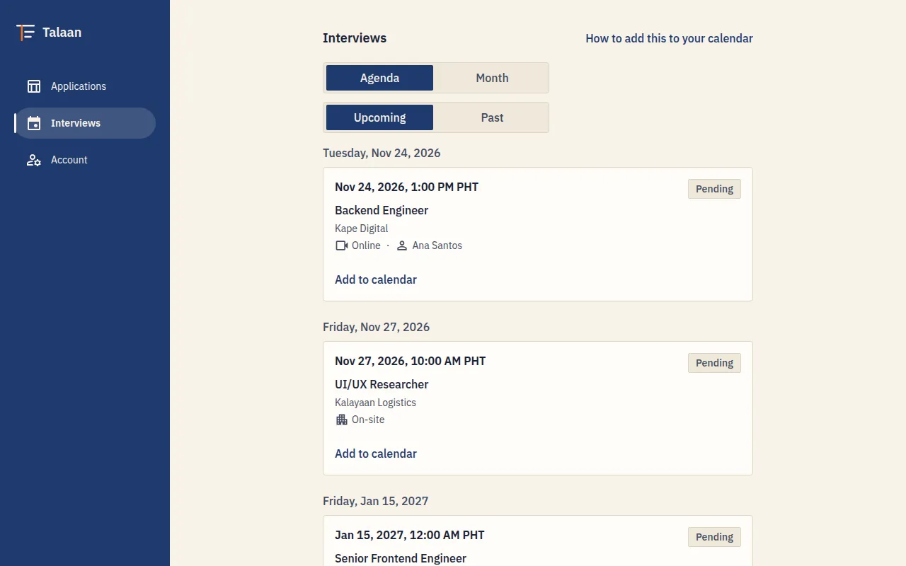
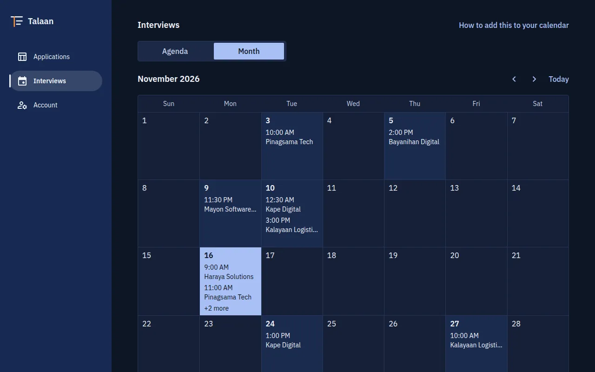
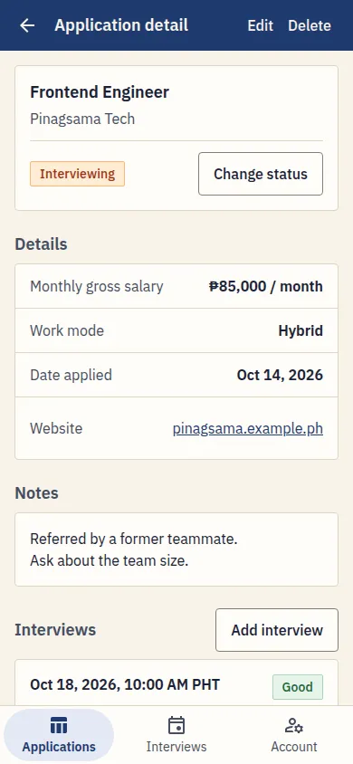
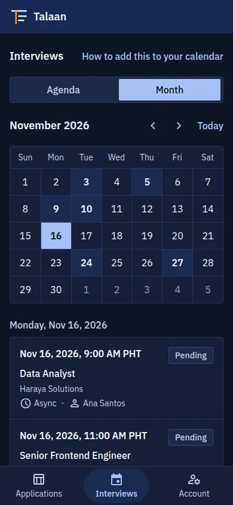
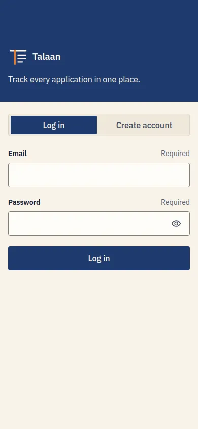
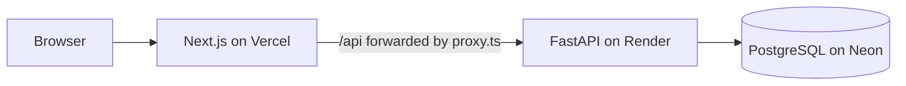

# Talaan

A job-application tracker for job seekers in the Philippines: log each application, track where it stands, and keep interviews on one agenda and calendar.



## Screenshots and live site

<table>
  <tr>
    <td></td>
    <td></td>
  </tr>
  <tr>
    <td></td>
    <td>
      
      
      
    </td>
  </tr>
</table>

Live at https://talaan-phi.vercel.app. Sign-up is invite-only and there is no demo account. The first request can take about 20 seconds while the free API server wakes up (a login after 20 idle minutes took 19 seconds, see `docs/DEPLOY.md`).

## Why it exists

Looking for a job in the Philippines usually means many applications at once. This app answers three questions: where does each application stand, when is the next interview, and can I check both from my phone. Times are shown in Philippine time and salaries are in pesos.

One decision worth knowing (details in [DECISIONS.md](DECISIONS.md)): the browser only talks to the Vercel origin, and the Next.js `proxy.ts` forwards `/api` to the API. The session cookie is therefore first-party (HttpOnly, SameSite=Lax) and there is no CORS. The trade-offs are an extra hop through Vercel on every call, free-tier limits, and the API seeing only Vercel's address, so the proxy forwards the visitor's IP together with a shared secret to keep rate limits per visitor. The rejected alternative was a `SameSite=None` cookie sent straight to the API host, which browsers increasingly block as a third-party cookie and which gives up the Lax protection against CSRF.

## Features

- Sign-up with an invite code, log in and log out, and account deletion that removes the account and all its data.
- Applications: create, edit and delete, with nine statuses (saved, applied, screening, interviewing, offered, accepted, rejected, withdrawn, ghosted), a status filter and Load more.
- Interviews per application: mode, outcome, interviewer and notes, with times in Philippine time.
- An agenda of interviews across all applications (Upcoming and Past) and a month calendar with keyboard navigation.
- A Needs follow-up view that lists applications at Applied with no activity for 7 days or more and no interview ahead.
- An `.ics` file for each upcoming interview, built in the browser, with a short guide to importing it.
- Light and dark theme that follows the system, with an override on the account screen.
- Phone, tablet and desktop layouts, with the list and detail side by side from 1280px.
- Rate limits on login, sign-up and account deletion.

## Tech stack



- Frontend: Next.js (App Router, TypeScript, Tailwind).
- Backend: FastAPI, SQLAlchemy, Alembic, PostgreSQL, bcrypt.
- Tests: pytest and Vitest. CI: GitHub Actions.

## Run it locally

Prerequisites: Python 3.14, Node 24, and Docker with Compose (the database is the `postgres:16` image).

```bash
cp .env.example .env
# edit .env: uncomment COOKIE_SECURE=false (plain http needs it)
docker compose up -d db
python3 -m venv .venv && source .venv/bin/activate && pip install -r requirements-dev.txt
alembic upgrade head
uvicorn app.main:app --reload --no-proxy-headers
```

In a second terminal at the repo root, create an invite code (sign-up needs one locally too; the code is printed once), then start the frontend:

```bash
source .venv/bin/activate && python -m app.admin create-invite
cd frontend && npm ci && npm run dev
```

Open http://localhost:3000 and sign up with the code. The frontend reaches the API at `http://localhost:8000` unless `BACKEND_URL` says otherwise (`frontend/README.md`). All local browsers share one rate-limit bucket, so raise the `LOGIN_*` and `SIGNUP_*` limits in `.env` if you hit them.

Tests and checks:

```bash
docker compose exec db createdb -U talaan talaan_test   # once
pytest                                                   # repo root, venv active
ruff check app tests alembic
cd frontend && npm run lint && npm run typecheck && npm test && npm run build
```

## Project docs

- [docs/DESIGN.md](docs/DESIGN.md): look, components and screens.
- [docs/ARCHITECTURE.md](docs/ARCHITECTURE.md): database schema.
- [docs/API.md](docs/API.md): the HTTP API.
- [docs/DEPLOY.md](docs/DEPLOY.md): deployment and what was measured live.
- [docs/ROADMAP.md](docs/ROADMAP.md): scope, done milestones and backlog.
- [DECISIONS.md](DECISIONS.md): decisions with their trade-offs.
- [frontend/README.md](frontend/README.md): frontend routes and scripts.

## Limitations and next steps

Limitations today:

- Sign-up is invite-only and there is no demo account.
- The free-tier API sleeps when idle, so the first request can take about 20 seconds.
- Philippine time and Philippine pesos only; there is no time zone or currency setting.
- No email verification and no password reset.
- Rate limits cover login, sign-up and account deletion; other authenticated routes are not rate limited (listed in the roadmap backlog).
- Only the current status is stored, with no status history.
- It is not installable as a PWA yet; nothing for that is built.
- The follow-up view lists applications at Applied whose last activity (the apply date or the latest past interview, in Philippine days) is 7 or more days ago and that have no interview ahead. The 7 days cannot be changed in the app (the API takes `days`, 1 to 90). There are no reminders, notifications or emails, and no way to mark a row as followed up.

Planned, not built (from the roadmap): a documents checklist per application and a rule-based scam red-flag check.

## Licence and contact

MIT, see [LICENSE](LICENSE).

Contact: GitHub, https://github.com/pcmnepomuceno
