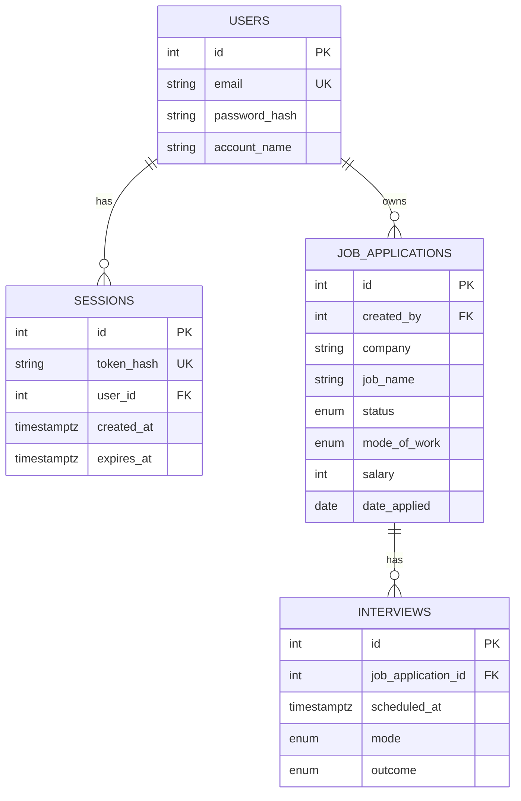

# Talaan: Architecture

## Stack
FastAPI, sync SQLAlchemy, PostgreSQL 16, Alembic, bcrypt. Sync routes only (see CLAUDE.md conventions).

## Domain layout
Done in Milestone 2 as a move-only commit. Applications and interviews have models and schemas only until CRUD.

```
app/main.py, config.py, database.py, health.py
app/auth/          router, schemas, models [Session], dependencies, security
app/users/         router, schemas, models
app/applications/  models, schemas, router, dependencies (service planned)
app/interviews/    models, schemas (router, service planned)
tests/             mirrors app/
```

## ERD

Columns are abridged; the full schema is in the Schema section below.

## Schema

Relationships: Users 1—N Job Applications 1—N Interviews; Users 1—N Sessions.
FKs live on the "many" side only (query `created_by`, never store lists on Users).

**Users** (matches model): id, email (UNIQUE), password_hash, account_name

**Sessions** (matches model; `user_id` ON DELETE CASCADE, indexed): id, token_hash (UNIQUE, SHA-256 hex of the `session_token`
HttpOnly cookie value; raw token never stored), user_id → Users.id, created_at, expires_at
(both `DateTime(timezone=True)`)

**InviteCodes** (matches model): id, code_hash (UNIQUE, SHA-256 hex of the normalized 12-char code; plaintext never stored),
note?, created_at, expires_at, used_at?, used_by_user_id? → Users.id (`ON DELETE SET NULL`, indexed `ix_invite_codes_used_by_user_id`)

**Job Applications** (matches model)
id, company, job_name, contact_website?, contact_email?, status (ENUM),
salary? (int), mode_of_work (ENUM), remarks, date_applied, created_at,
updated_at, created_by → Users.id
- `salary`: monthly gross, PHP, no currency column. `remarks` nullable. `date_applied` is a nullable `Date`; non-`saved` rows get today (Asia/Manila) if none is sent.
  `saved` is first in the status ENUM.
- ENUMs: status = applied/screening/interviewing/offered/accepted/rejected/withdrawn/ghosted;
  mode_of_work = on_site/hybrid/remote.

**Interviews** (matches model)
id, job_application_id → Job Applications.id, interviewer, scheduled_at
(tz-aware; spec renamed from `datetime`, model already uses `scheduled_at`),
mode (ENUM: on_site/online/async), outcome (ENUM: good/bad/pending), remarks,
created_at, updated_at
- `interviewer` and `remarks` nullable. mode = on_site/online/async;
  outcome = pending/good/bad (default pending).

ENUM value lists and column choices are logged in DECISIONS.md (2026-10-20).

## Sessions vs OWASP Session Management
Matches:
- Random, unguessable token (`secrets`, 256 bits). The cookie holds the raw token; the database stores only its SHA-256 hex digest (`sessions.token_hash`), so a leaked dump holds no working logins.
- `HttpOnly` cookie; logout and expiry delete the row (instant revocation).
- Same 401 for unknown email and wrong password.

Planned (v1b): `Secure` and `SameSite=Lax` via config, rate limiting on login/signup.

Deliberate deviations:
- **30-day absolute lifetime**, no idle timeout, no sliding renewal. Data is low-stakes; convenience wins (DECISIONS.md).
- **No token rotation at login-time privilege change**: there are no roles.

## Testing
- Separate `*_test` database. A guard aborts unless the database name the driver will receive ends in `_test`. After the app imports, it checks `app.database.engine.url` again. Before each alembic command the tests run (through `run_alembic` in `tests/conftest.py`), it checks the two URLs `alembic/env.py` reads: `app.database.engine.url` and `app.config.DATABASE_URL`. Refusal messages show only the driver and the database name.
- Schema built once per run with `alembic upgrade head` (tests the migrations too).
- Each test runs in a connection-level transaction with a savepoint, rolled back at the end.
- `pytest` + `httpx` against the FastAPI app.

## Deploy topology
- Render free web service (Docker) + Neon free Postgres.
- App uses the Neon **pooled** URL; migrations use the **direct** URL. `pool_pre_ping=True` survives dropped connections.
- Container entrypoint runs `alembic upgrade head`, then `exec uvicorn ... --proxy-headers` (so signals reach uvicorn and client IPs are right behind Render's proxy).
- `.dockerignore` excludes `.env`; secrets are Render env vars.
- Cold starts: free instances sleep. A cheap `/ping` (no DB) lets a free uptime pinger keep it warm. The frontend must show a loading state while the API wakes.

## Future frontend
Vercel hosts the PWA. `vercel.json` rewrites `/api/*` to Render, so the browser sees one origin and cookies stay first-party.

## Caching
Authenticated responses send `Cache-Control: no-store`.

## CI
GitHub Actions (`.github/workflows/ci.yml`, free tier, no secrets). Runs on every pull request and every push to `main`; a newer push to the same branch cancels the older run.

One job, Python 3.14, Postgres 16 service container with database `talaan_test`. Config comes only from env vars: `DATABASE_URL` and `TEST_DATABASE_URL` both point at `talaan_test` (alembic reads the first, the test guard reads the second). Steps, each shown separately:
1. `pip install -r requirements-dev.txt` (pip cache on)
2. `ruff check app tests alembic`
3. `alembic upgrade head`
4. `alembic check`
5. `pytest -q`

Reproduce locally (with `docker compose up -d db` running):

    docker compose exec db createdb -U talaan talaan_ci_test
    export DATABASE_URL=postgresql+psycopg2://talaan:<password>@localhost:5432/talaan_ci_test
    export TEST_DATABASE_URL=$DATABASE_URL
    .venv/bin/python -m ruff check app tests alembic
    .venv/bin/python -m alembic upgrade head
    .venv/bin/python -m alembic check
    .venv/bin/python -m pytest -q
    docker compose exec db dropdb -U talaan talaan_ci_test

## Docker
`Dockerfile` builds the API on `python:3.14-slim` (same minor as CI). It installs `requirements.txt` only, runs as non-root user `app` (uid 10001) and starts one uvicorn worker on `0.0.0.0:${PORT:-8000}`. A `HEALTHCHECK` calls `/ping` with Python's stdlib. `.env`, `.git`, `tests` and `docs` are not in the image. Config comes from env vars only. Compose sets `DATABASE_URL` with host `db`.

Migrations never run on start. Apply them by hand:

    docker compose build                  # build the image
    docker compose up -d                  # db + api (api waits for db healthy)
    docker compose run --rm api python -m alembic upgrade head   # migrate
    docker compose logs -f api            # follow logs
    docker compose stop                   # stop, keep data
    docker compose down                   # remove containers, keep the volume

Reset the database: `docker compose down -v` deletes the `talaan_pgdata` volume and **all data**. Run `alembic upgrade head` again after `up`.

If the API starts before migrations, `/ping` and `/health` return 200 (`SELECT 1` needs no tables) and table routes return 500 with `relation "users" does not exist` in the logs. Run the migrate command; no restart is needed.

## Privacy and data
- Stored: email, password hash, account name, applications, interviews, session tokens.
- Sent to LLM providers: nothing today. From v1.2, only text the user explicitly submits, using their own key.
- Free-tier Gemini keys may use prompts for model training. The UI must warn before a user pastes personal text with such a key.
- No CV files are stored. Any CV feature (v2) uses an opt-in structured profile.
- Deletion on request now; self-serve account deletion in v1b.

## Extension points (hooks only, nothing built)
- **API tokens** (E3, docs/ROADMAP.md): hashed personal tokens for the browser extension; planned to be accepted only by a quick-add endpoint that can only create an application, not as a general `Authorization: Bearer` login in `get_current_user`.
- **LLM provider interface**: one small interface behind which LiteLLM sits; BYO key, encrypted at rest, never logged.
- **JobSource interface**: yields job postings from legitimate feeds.
- **Per-user ownership**: every query is scoped by `created_by` through shared dependencies.
- **Secrets**: env vars only, never in git or logs.

Dev note: the Claude Code login is not an API key and must never power the app.

## Known limitations
Cold starts on free tier; Neon free-tier limits; no idle timeout; single region; no status history; no email delivery.

## Credits and inspiration
Ideas only, no copied code: career-ops (MIT), Resume-Matcher (Apache-2.0), JobSpy (MIT).
